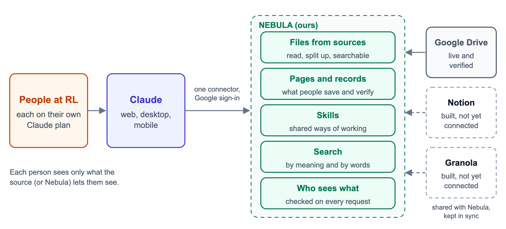
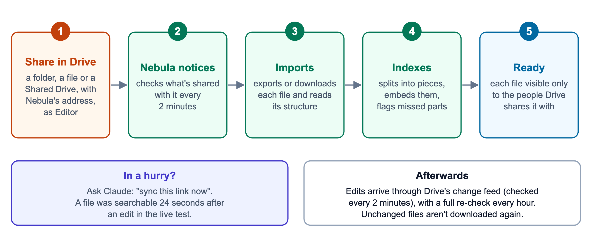
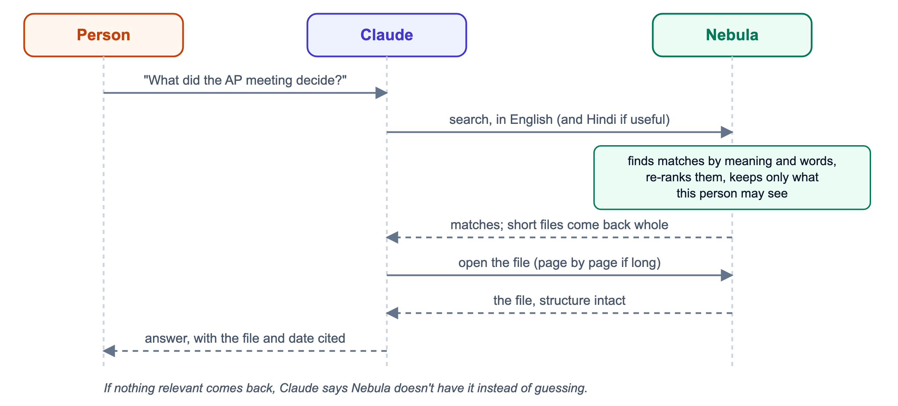
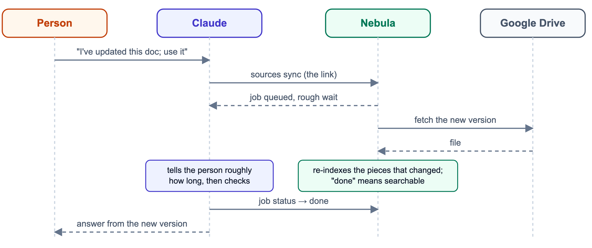
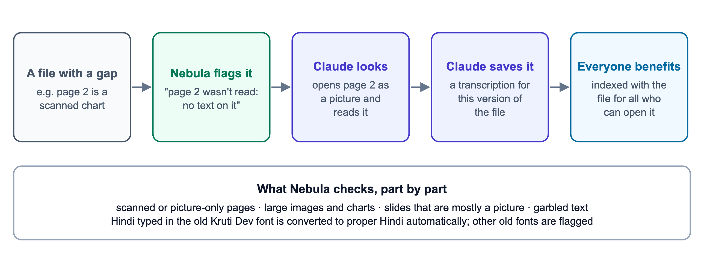
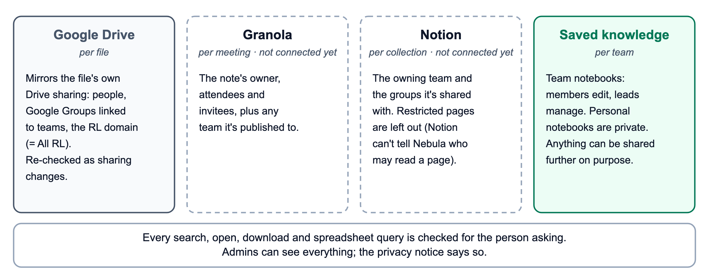
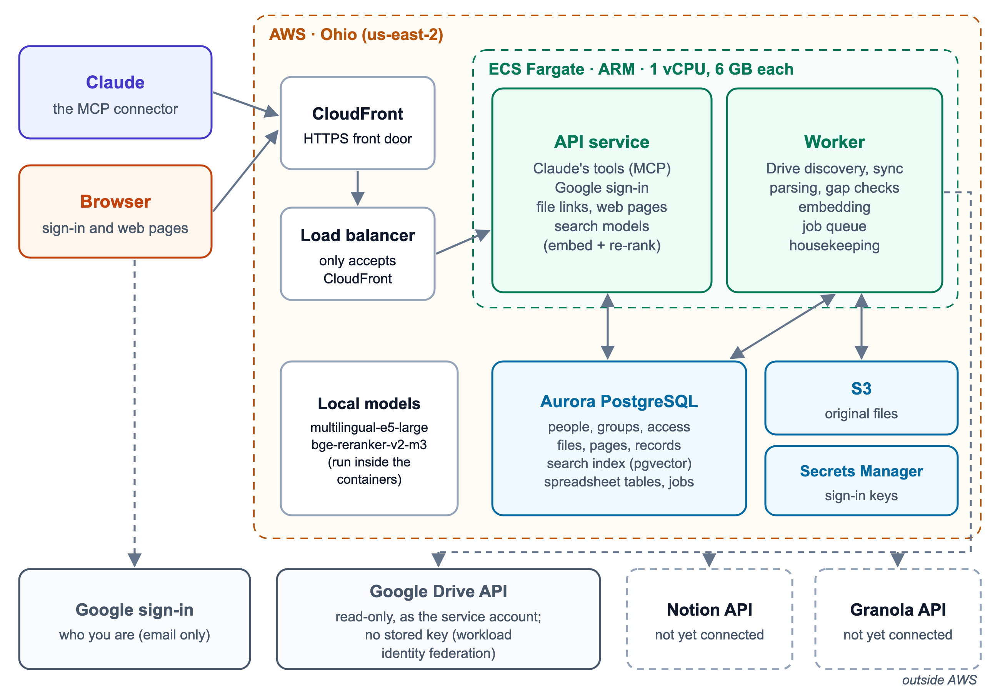
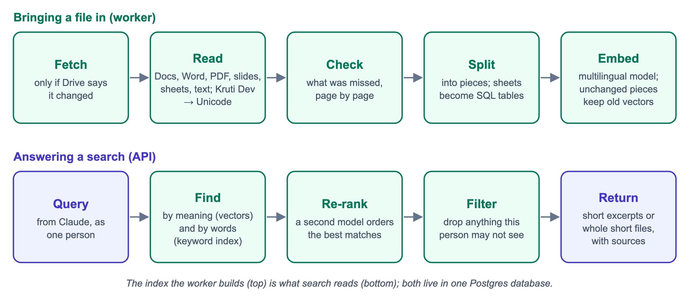

# Nebula

Nebula is an organisation's memory for Claude. It's an MCP server that people add to their own Claude as one connector. From then on, Claude can answer questions from the organisation's actual documents, keep what people learn, and show each person only what they're allowed to see.

Tested it end to end in October 2026 on a live AWS deployment, with Google Drive and real Claude conversations. Google Drive works fully. Notion and Granola connectors are built and tested offline, but haven't been connected to live accounts.



A six-page overview with all the diagrams is in [docs/Nebula-Overview.docx](docs/Nebula-Overview.docx).

## How it works

Everything happens inside Claude. Each person adds Nebula once as a custom connector and signs in with their Google account.

**Bringing documents in.** Someone shares a Drive folder, a single file or a whole Shared Drive with Nebula's Google service account, as an **Editor**. Nebula only ever reads (its Google access is read-only), but Drive only tells editors who a file is shared with, and Nebula needs that to decide who may see each file. Nebula checks for new shares every two minutes, then imports and indexes them. Each file stays visible only to the people Drive shares it with, and a file reached through two folders is stored once.



**Asking a question.** Claude searches Nebula first whenever someone asks about the organisation's work. Nebula finds matches by meaning and by exact words, re-ranks them, and removes anything the person isn't allowed to see before Claude gets the results. Claude reads short files whole and opens longer ones in full rather than answering from fragments. It cites the file and its date, and when nothing relevant exists it says so instead of guessing.



**Keeping files current.** Edits reach Nebula through Drive's change feed, which it checks every two minutes. Only files whose content changed are downloaded again, and only the changed parts are re-indexed. Someone who can't wait can tell Claude "I've updated this doc, use the new version". Claude then refreshes that one file and answers once it's ready; in testing that took 24 seconds.



**Reading what text extraction missed.** Plain extraction misses scanned pages, charts and pictures of tables. Nebula checks every file part by part and lists what it couldn't read. Claude can open such a part as an image, read it, and save what it says back to Nebula, where it becomes searchable for everyone who can open the file. Hindi typed in the old Kruti Dev font, common in Indian government documents, is converted to proper Hindi automatically.



**Saving and sharing knowledge.** People can ask Claude to save a decision, a corrected figure, a lesson or a summary page. Saved items have an owner and are marked draft or verified, corrections keep their history, and edits to a verified page arrive as proposals for its owner. Teams can share ways of working as skills, and a lead can hand work over when someone changes role.

**Who can see what.** Each source works differently:
- **Drive files** follow their own Drive sharing, including Google Groups linked to teams and the organisation's domain.
- **Granola meeting notes** are visible to the people who were in the meeting.
- **Notion** can't tell Nebula who may read a page, so a Notion collection is shared with a whole team and restricted pages are left out.

Every search, open, download and spreadsheet query is checked against the person asking.



## Try it locally

You need [Docker](https://www.docker.com/) and [uv](https://docs.astral.sh/uv/). It takes about ten minutes and needs no Google or AWS account.

```bash
# 1. Postgres with pgvector
docker run -d --name nebula-pg -e POSTGRES_USER=nebula -e POSTGRES_PASSWORD=nebula \
  -e POSTGRES_DB=nebula -p 5433:5432 pgvector/pgvector:pg17

# 2. The app, in dev mode (no sign-in; every request acts as dev@example.org)
uv sync
cp .env.example .env
uv run nebula migrate

# 3. Sample documents: meeting notes, a spreadsheet, and a Hindi notice typed in Kruti Dev
uv run python examples/load_samples.py
uv run nebula eval examples/eval-cases.json --as dev@example.org

# 4. Start the MCP server at http://localhost:8000/mcp (and the worker in a second terminal)
uv run nebula serve
uv run nebula worker
```

`.env.example` starts with `NEBULA_EMBED_PROVIDER=fake`, which runs instantly but only matches shared words. To use the real multilingual models, set `NEBULA_EMBED_PROVIDER=local` and `NEBULA_RERANK_PROVIDER=local` (about 2.8 GB, downloaded once), then load the samples again.

Then connect a client to `http://localhost:8000/mcp`:

- **Claude Code:** `claude mcp add --transport http nebula http://localhost:8000/mcp`
- **MCP Inspector:** `npx @modelcontextprotocol/inspector`, then choose Streamable HTTP and the same address.

Some things to ask Claude:
- "What did the October programme review decide about teacher training?"
- "What does the Hindi district notice say?" (it was typed in Kruti Dev; Nebula converted it)
- "Which district had more active centres in September?" (Claude answers with SQL over the spreadsheet)
- "Save a decision: Krishna pilots refresher sessions in December."
- "Upload this PDF to Nebula" (Claude Code uploads it with curl, and the worker indexes it). With a scanned page, ask Claude to read the part Nebula couldn't.

Claude on the web (claude.ai) needs a public HTTPS address with Google sign-in, so use the deployment below for that. Never expose dev mode on a public address.

## Connect Google Drive (optional)

1. In a Google Cloud project, enable the Google Drive API and create a service account. For local use, create a JSON key for it.
2. Put the key in `.env` as one line: `NEBULA_GOOGLE_SERVICE_ACCOUNT_JSON={"type": "service_account", ...}`.
3. Set `NEBULA_DEV_USER_EMAIL` to your own Google address, so dev mode acts as you. Each file is only visible to the people Drive shares it with.
4. In Drive, share a folder with the service account's email address, as **Editor**.
5. With the worker running, Nebula picks the folder up within two minutes. Run `uv run nebula discover` to do it immediately. `uv run nebula probe-drive <folder link>` checks, read-only, what the service account can see.

On AWS, Nebula holds no Google key. The container's AWS identity is exchanged for a short-lived Google token through workload identity federation; see [infra/README.md](infra/README.md).

## Tests and evaluation

```bash
docker exec nebula-pg psql -U nebula -c "create database nebula_test"   # once
uv run pytest -q
```

The 140 tests use stand-in models and mocked source APIs. They cover the product through its MCP tools, including access rules, Drive sync, legacy font conversion, picture reading, storage and limits.

`nebula eval` checks your own questions against known answers, layer by layer, without spending Claude tokens. For each question it checks:
- whether the expected text was extracted at all;
- whether search returns the file for that person, and how high;
- whether the excerpt shows the answer;
- whether files that person mustn't see stay out.

The case format is in [src/nebula/evaluate.py](src/nebula/evaluate.py), with examples in `examples/eval-cases.json`. [ops/eval/claude_checks.md](ops/eval/claude_checks.md) lists the checks that need a real Claude conversation.

## Deploy

[infra/README.md](infra/README.md) has an AWS CDK stack: CloudFront and a load balancer in front of two containers (the API and a worker), Aurora PostgreSQL with pgvector, and S3. The stack bills around the clock even when nobody uses it: about $166 a month at idle at on-demand prices in us-east-2.


[docs/Nebula-Running-Cost.docx](docs/Nebula-Running-Cost.docx) shows how each number is worked out. Set a budget alert before deploying.

## How it's built





Nebula is Python ([FastMCP](https://gofastmcp.com), psycopg, pgvector). One PostgreSQL database holds everything: people, groups and access, file contents, saved knowledge, the search index, spreadsheet tables and the job queue. Original files go to S3, or to a local folder in development. Search uses multilingual-e5-large for meaning and bge-reranker-v2-m3 for re-ranking, run locally with fastembed, so English and Hindi both work.

Claude sees eleven tools. claude.ai ignores a connector's general instructions, so each tool's description is effectively the manual:

| Tool | Used for |
|---|---|
| `search`, `open`, `query` | Finding things, reading them in full (or a page as an image), SQL over spreadsheets |
| `save`, `share`, `people` | Saving knowledge and transcriptions, deciding proposed edits, sharing, who's who |
| `sources`, `job` | Bringing Drive material in, refreshing it now, and checking progress |
| `skills`, `file` | Shared ways of working; moving files between Claude's workspace and Nebula |
| `admin` | Teams, collections, review and handover (leads and admins only) |

| Path | What's there |
|---|---|
| `src/nebula/server.py` | The MCP tools and their descriptions |
| `src/nebula/sources.py`, `sync.py` | The Drive source: discovery, sync, refreshing one file |
| `src/nebula/connectors/` | Google Drive, Notion and Granola |
| `src/nebula/ingest/` | Parsing files, legacy Hindi fonts, finding missed parts, rendering pages as images |
| `src/nebula/knowledge/` | Items, pages and records, the search index and hybrid search, spreadsheet tables |
| `src/nebula/access.py`, `org.py` | Who can see and change what; groups, sharing, handover |
| `src/nebula/jobs.py`, `worker.py` | The job queue in Postgres, and the background worker |
| `src/nebula/migrations/` | The database schema |
| `infra/` | The AWS CDK stack |
| `examples/` | Sample documents, a loader and evaluation cases |

## What we verified

On the live deployment, with real Drive files and real Claude conversations:

| What we tested | Result |
|---|---|
| Connecting Nebula to Claude and signing in with Google | Works |
| Finding and reading a shared Drive file | Each of the five people it was shared with found it and got the full text |
| The same file, for someone it isn't shared with | Couldn't find it or open it |
| Sharing a folder with Nebula | Picked up automatically, with who shared it |
| Editing a file in Drive | Change detected; searchable 24 seconds after a refresh request |
| "Use the new version" in a chat | Claude refreshed the file, waited, and answered from the new version |
| A long document (33,000 characters) | Read in full |
| A page that is only a chart | Claude read it from the image and saved it; it became searchable |
| A question the documents can't answer | Claude said Nebula doesn't have it rather than guessing |

## Still open

- Notion and Granola aren't connected to live accounts yet.
- Shared Drives haven't been tested live.
- Search speed hasn't been measured at scale.
- Writing changes back to Drive isn't built.
