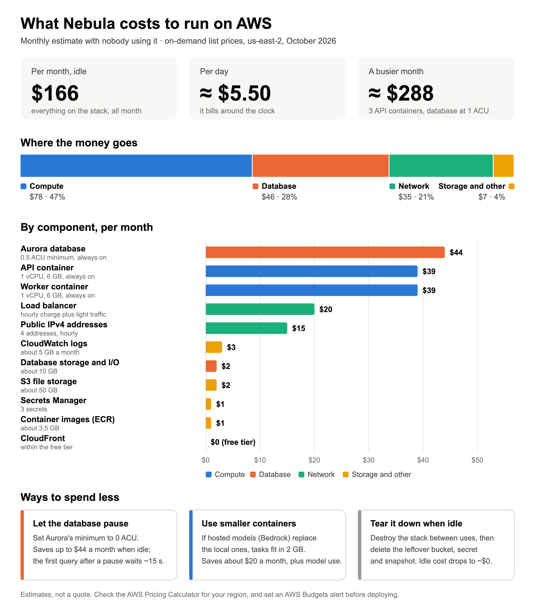

# Deploying Nebula on AWS (CDK)

One CDK stack, `Nebula`, deployed to the account and region of your AWS credentials (us-east-2 unless you set `NEBULA_AWS_REGION`). It's a separate uv project, so the CDK dependencies stay out of the app's environment.

```
Claude ──HTTPS──► CloudFront (*.cloudfront.net)
                      │ HTTP + a secret origin header
                      ▼
                  Load balancer :80 (only accepts CloudFront; 403 without the header)
                      │
                      ▼
       ECS Fargate ARM64, public subnets (no NAT)
          nebula-api    (nebula serve, :8000)  ──┐
          nebula-worker (nebula worker)        ──┼──► Aurora PostgreSQL 17 Serverless v2 (isolated subnets)
                                                 ├──► S3 nebula-files-<account>-<region> (gateway endpoint)
                                                 └──► Internet: Google, Notion, Granola, ECR, Secrets Manager
```

## Before you deploy: cost

The stack bills around the clock, whether or not anyone uses it. At on-demand list prices in us-east-2 that's about $166 a month at idle, and about $288 in a busier month. Most of it is the parts that never switch off: the two 6 GB containers (the local search models need the memory), Aurora's 0.5 ACU minimum, the load balancer and the public IPv4 addresses.



[docs/Nebula-Running-Cost.docx](../docs/Nebula-Running-Cost.docx) shows how each line is priced. Prices change, so check the AWS Pricing Calculator for your region, set an AWS Budgets alert before deploying, and tear the stack down when you're not using it.

## Prerequisites

- An AWS account, with credentials in your shell (`aws sts get-caller-identity` should work)
- Node (for `npx aws-cdk@2`), uv, and Docker running (the deploy builds the ARM64 image locally)
- A Google Cloud project for sign-in (an OAuth client) and, for Drive, a service account
- For ECS Exec, the Session Manager plugin

## Deploy

```sh
cd infra
npx aws-cdk@2 bootstrap aws://<account-id>/<region>   # once per account and region
npx aws-cdk@2 synth                                    # sanity check, no AWS changes
npx aws-cdk@2 deploy Nebula                            # builds the image, pushes it, deploys
```

The first deploy takes 20–30 minutes; Aurora and CloudFront are the slow parts. The image is about 3.5 GB because the search models are baked in. Later deploys that only change `src/` rebuild just the top layer. The database schema is created when the app starts.

After the first deploy:

1. Set the values in the `nebula/app` secret (below).
2. In your Google OAuth client (type: web application), add two authorised redirect URIs: the stack output `GoogleRedirectUri` (`<PublicUrl>/auth/callback`, for Claude) and `<PublicUrl>/web/callback` (for the web pages).
3. Restart both services so they pick up the secret.

The stack outputs `McpUrl`, the address people paste into Claude as a custom connector.

### Settings

These are in `cdk.json` under `context` and become environment variables. Override any of them for one deploy with `-c`, for example `npx aws-cdk@2 deploy Nebula -c nebula:adminEmails=you@your-org.org`.

| Context key | Env var | Default |
|---|---|---|
| `nebula:publicSignup` | `NEBULA_PUBLIC_SIGNUP` | `false`: only allowed domains and emails can sign in |
| `nebula:allowedEmailDomains` | `NEBULA_ALLOWED_EMAIL_DOMAINS` | `example.org`; set your organisation's domain |
| `nebula:allowedEmails` | `NEBULA_ALLOWED_EMAILS` | empty |
| `nebula:adminEmails` | `NEBULA_ADMIN_EMAILS` | empty |
| `nebula:embedProvider` | `NEBULA_EMBED_PROVIDER` | `local` (or `bedrock-cohere` where Bedrock is available) |
| `nebula:rerankProvider` | `NEBULA_RERANK_PROVIDER` | `local` |

The stack also sets `NEBULA_AUTH_MODE=google`, the bucket, the region and `NEBULA_PUBLIC_URL`.

With `publicSignup=true` any verified Google account can sign in. It gets its own notebook and only what's explicitly shared with it. Only the allowed domains count as members of the organisation.

### The app secret

`nebula/app` is one JSON object. It holds:
- `GOOGLE_CLIENT_ID` and `GOOGLE_CLIENT_SECRET` for sign-in;
- `GOOGLE_SERVICE_ACCOUNT_JSON` for Drive;
- `NOTION_TOKEN` and `GRANOLA_API_KEY`.

They all start as `"unset"`. `JWT_SIGNING_KEY` is generated for you; leave it alone, because changing it signs everyone out. Merge your values in without writing them to disk:

```sh
aws secretsmanager get-secret-value --secret-id nebula/app --query SecretString --output text \
| jq --arg id "<google-oauth-client-id>" --arg sec "<google-oauth-client-secret>" \
     '.GOOGLE_CLIENT_ID=$id | .GOOGLE_CLIENT_SECRET=$sec' \
| aws secretsmanager put-secret-value --secret-id nebula/app --secret-string file:///dev/stdin

aws ecs update-service --cluster nebula --service nebula-api    --force-new-deployment >/dev/null
aws ecs update-service --cluster nebula --service nebula-worker --force-new-deployment >/dev/null
```

Don't change the secret's template in `nebula_stack.py` after the first deploy: CloudFormation would regenerate the whole secret and wipe the values you set.

### Drive access without a key

On AWS, Nebula reads Drive as a Google service account without storing a key, through workload identity federation:

1. In Google Cloud, create a workload identity pool with an AWS provider. Restrict it to your AWS account and the stack's ECS task role.
2. Allow that identity to impersonate the service account (Service Account Token Creator), and enable the Drive API.
3. Download the pool's credential configuration (the `external_account` JSON) and put it in `GOOGLE_SERVICE_ACCOUNT_JSON`.

The service account needs no project roles. People share folders with its email address, as Editor; Nebula's access stays read-only.

## Resources

| Resource | Notes |
|---|---|
| VPC | Two AZs, public and isolated subnets, no NAT gateway. The S3 gateway endpoint is free. |
| Aurora PostgreSQL 17 Serverless v2 | 0.5–4 ACU, encrypted, 7-day backups, final snapshot on delete. The app enables pgvector itself. |
| Secrets `nebula/db`, `nebula/app`, `nebula/origin-verify` | Database credentials, app credentials, and the CloudFront-to-load-balancer header. `nebula/app` is kept when the stack is deleted. |
| S3 `nebula-files-<account>-<region>` | Original files. Versioned, encrypted, no public access; deleted versions expire after 7 days. Kept when the stack is deleted. |
| ECS services `nebula-api`, `nebula-worker` | 1 vCPU / 6 GB each. The API scales from 1 to 3 tasks; health check on `/healthz`; ECS Exec on. |
| CloudFront | Default certificate, HTTPS only, caching off, all headers forwarded (the MCP sign-in needs Host and Authorization). |
| Logs `/nebula/api`, `/nebula/worker` | Kept for a month. |

## Operating it

```sh
aws logs tail /nebula/api --follow
aws logs tail /nebula/worker --follow

# a one-off command inside the worker, e.g. a read-only Drive check or discovery
TASK=$(aws ecs list-tasks --cluster nebula --service-name nebula-worker --query 'taskArns[0]' --output text)
aws ecs execute-command --cluster nebula --task "$TASK" --container worker --interactive \
  --command "nebula probe-drive <folder link>"
```

## Things to know

- **Timeouts.** CloudFront waits at most 60 seconds between bytes from the load balancer, so long work runs as background jobs.
- **Memory.** The two local models take about 2.8 GB. Model calls run in small batches, one at a time per container, to keep memory bounded.
- **Custom domain.** You need an ACM certificate in us-east-1 on the distribution. Then update `NEBULA_PUBLIC_URL` and the Google redirect URI.
- **Tearing down.** `npx aws-cdk@2 destroy Nebula` leaves the S3 bucket, the `nebula/app` secret and a final Aurora snapshot behind, and they keep costing a little. Delete them by hand. Their fixed names also block a fresh deploy until they're gone.
